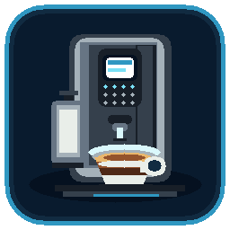

# DeLonghi Dinamica Plus – Home Assistant (BLE)

**Unofficial local Bluetooth Low Energy integration** for the **De'Longhi Dinamica Plus ECAM 370.95.T**.

The integration was developed and tested on the ECAM 370.95.T with Home Assistant and an **ESPHome Bluetooth proxy**. It communicates with the coffee machine locally; no De'Longhi cloud account is required. Compatibility with other ECAM models has **not** been established.

## Current features (v0.2.24)

- Display **machine status** (including off, heating, ready, brewing, rinsing) and whether the machine is switched on.
- Manually **switch the machine on** from Home Assistant. Switching off and starting a beverage are **not supported**.
- Display machine warnings where reported by this model: **water tank empty**, **grounds container full**, **descaling required**.
- Read statistics: total coffee and milk-coffee beverages, water consumption, descaling count and milk-system cleaning count.
- Read profile names and the six configurable custom drink names, including their icon IDs.
- Read **six shared configurable drink recipes** (coffee volume, milk duration, strength), not eighteen profile-specific duplicates.
- Select a custom drink in a dropdown, edit its name and recipe values locally, and **save explicitly using one button**. The integration reads the values back to verify whether the machine accepted them.
- Read machine status every **15 seconds** and refresh recipes/statistics every **120 seconds** (subject to BLE connection delays).
- Support Home Assistant Bluetooth, including an ESPHome BLE proxy.
- Ship a local integration icon for Home Assistant 2026.3+.

## Requirements

- Home Assistant with the Bluetooth integration enabled.
- A reliable BLE connection to the coffee machine, directly from the Home Assistant host or through an **ESPHome Bluetooth proxy** (the tested setup).
- The machine's Bluetooth MAC address.
- **Only one active BLE client** at a time. The official Coffee Link app and another De'Longhi BLE integration may interfere with this integration.

## Installation with HACS

1. In **HACS → ⋮ → Custom repositories**, add `https://github.com/Sepp501/delonghi-dinamica-hacs` as an **Integration**.
2. Install **DeLonghi Dinamica Plus** and restart Home Assistant.
3. Go to **Settings → Devices & services → Add integration** and select **DeLonghi Dinamica Plus (Development)**.
4. Enter your machine's Bluetooth MAC address. Ensure the machine is reachable by Home Assistant Bluetooth or the ESPHome proxy.
5. Open the newly created **DeLonghi Dinamica Plus** device to inspect the sensors and configuration controls.

The name still contains “(Development)” to distinguish this community project from an official integration.

## Editing a drink

The six custom drink slots are **shared between the machine's user profiles**. Changing a custom drink is not creating a separate recipe per user.

1. Open the device's **Configuration** section or create your own dashboard using the same entities.
2. Choose the desired entry under **Getränk konfigurieren** (recipe IDs `230`–`235`).
3. Edit **Getränkename (Entwurf)**, **Kaffeemenge (Entwurf)**, **Milchdauer (Entwurf)** and/or **Stärke (Entwurf)**.
4. Press **Rezept speichern** once.
5. The integration verifies the saved name by reading `0xAA` and recipe values by reading `0xA6`. A successful BLE write acknowledgment **alone** does not imply that the machine saved the change.

Editing the fields does not immediately change the machine; the Save button triggers the write. Switching to another drink reloads the selected drink's draft and discards unsaved changes for the previous drink.

**Supported input limits:** coffee 100–240 mL (5 mL steps), milk 0–90 s (0.1 s steps), strength 1–5, names at most 10 UTF-16 code units. Individual recipes may have additional limitations: for example, the integration refuses to add a milk ingredient to a recipe that has none.

## How it works

The integration communicates with the machine using its local BLE GATT interface. It reads the state via `0x75`, profile names via `0xA4`, custom drink names via `0xAA`, recipe data via `0xA6`, and selected statistics via `0xA2`.

Recipe-name updates use the app-observed `0xAB` packet format (including UTF-16BE names and CRC). The 29-byte packet is sent as **20-byte + 9-byte sequential acknowledged GATT writes**, so a larger negotiated MTU is not required for this operation. Recipe-value changes use the `0x83` save path with readback verification.

Read requests and writes are coordinated to avoid overlapping GATT operations. During a full data refresh the status may take longer than the normal 15-second polling interval.

## Current limitations and cautions

- **Tested hardware:** ECAM 370.95.T only. Other devices may use different protocol fields or semantics.
- **No beverage start**, **no stop**, and **no power-off** control.
- Saving recipe values is a powerful, model-specific operation. Use cautiously, check the results on the machine and retain any original values you want to restore.
- A failed or interrupted BLE connection may delay updates. After a restart, allow the proxy and integration to reconnect before saving changes.
- Not all potential machine alarms are reliable on this model. Unsupported **coffee-beans-empty** and **filter-change** entities were deliberately removed.
- A shared recipe bank is based on the observed behavior of the tested model; the integration should not be assumed to offer independent recipes per user profile.
- The Coffee Link app and other BLE clients should not be connected at the same time.

## Troubleshooting

- **Machine unavailable:** check power, BLE range, ESPHome proxy connectivity and whether another BLE client is connected.
- **Status updates slowly:** the normal status interval is 15 seconds, but a fresh BLE connection or the 120-second full refresh can increase the delay.
- **Save reports an error:** do not assume the write failed or succeeded. Refresh the machine and inspect the selected recipe's actual readback before trying again.
- **Integration icon is missing:** update to the latest version, restart Home Assistant, then refresh/reopen the Home Assistant app to clear cached brand assets.

## Development, credits and attribution

This project is an **independent, unofficial Home Assistant integration**. It uses publicly documented De'Longhi BLE protocol research and additional observations of the De'Longhi Coffee Link Android app (v4.9.6). The app itself and its proprietary code are **not distributed** here.

The following open-source projects materially informed the research and implementation:

- **[Arbuzov / home_assistant_delonghi_primadonna](https://github.com/Arbuzov/home_assistant_delonghi_primadonna)** — prior Home Assistant De'Longhi BLE integration, documented commands, machine states, alarms and statistics; **Apache License 2.0**.
- **[asaf5767 / barista](https://github.com/asaf5767/barista)** — community De'Longhi BLE research and recipe-command handling; **MIT License**.
- **[Home Assistant](https://github.com/home-assistant/core)**, **[Bleak](https://github.com/hbldh/bleak)** and **[bleak-retry-connector](https://github.com/Bluetooth-Devices/bleak-retry-connector)** — platform APIs/libraries used by the integration, subject to their respective upstream licenses.

Protocol facts and packet identifiers are not necessarily copyright-protected source code. However, **if source code from another project is copied or adapted**, its copyright notices and license conditions must be preserved. See [THIRD_PARTY_NOTICES.md](THIRD_PARTY_NOTICES.md) and the repository [LICENSE](LICENSE). No claim of permission to reuse proprietary Coffee Link application code is made.

**Trademark disclaimer:** De'Longhi, Dinamica Plus and Coffee Link are trademarks of their respective owners. This project is **not affiliated with or endorsed by De'Longhi**; the included icon is unofficial artwork and does not reproduce the De'Longhi logo.

## License

This repository is distributed under the **Apache License, Version 2.0**; see [LICENSE](LICENSE). Third-party materials, when applicable, retain their own licenses and notices.
